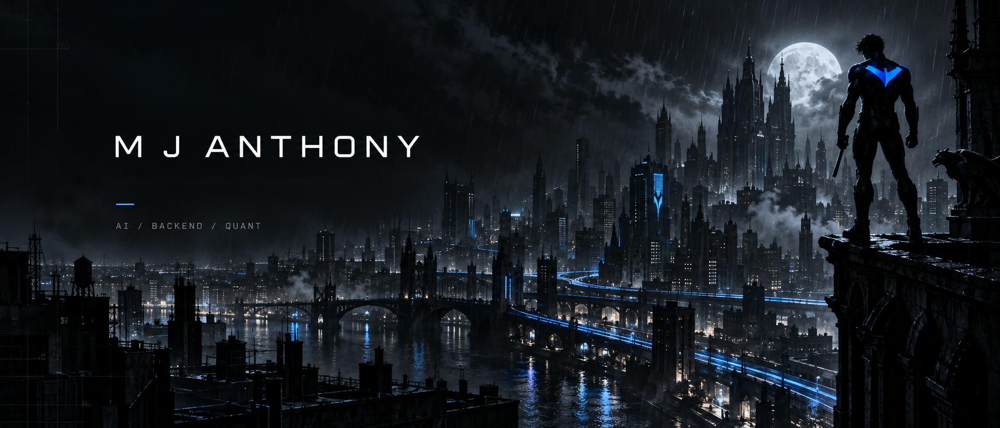
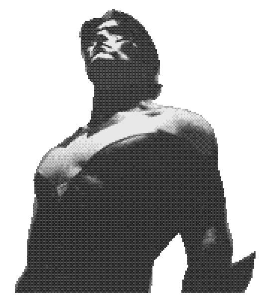

<p align="center"></p>

<p align="center"><samp>SYSTEM STATUS: ONLINE · STATIC PROFILE CONSOLE</samp></p>

```text
┌── NIGHTWING OPERATIONS ──────────┐

<p align="center"><samp>SYSTEM STATUS: ONLINE · STATIC PROFILE CONSOLE</samp></p>

```text
┌── NIGHTWING OPERATIONS ──────────┐
│ ID       : MJ-ANTHONY             │
│ SPECIALTY: AI / BACKEND           │
│ LOCATION : VIT-AP, INDIA          │
│ STATUS   : ALWAYS LEARNING        │
└───────────────────────────────────┘
```

<h1 align="center">Hi , I'm Anthony</h1>
<h3 align="center">AI / ML &amp; Backend Development</h3>
<p align="center">Computer Science student from India, exploring machine learning and backend systems.</p>

<p><samp>01 / IDENTITY</samp></p>
<h2>About Me</h2>




I enjoy turning ideas into practical solutions using Python, FastAPI, Next.js, and Java. I'm also exploring quantitative finance, strengthening my problem-solving skills, and continuously learning through hands-on projects and experimentation.

Inspired by **Nightwing's independence, discipline, and determination**, I believe in carving my own path, learning from every challenge, and building things that make a difference.

**Learn. Build. Adapt. Keep going.** 

<br clear="right" />

<p><samp>02 / OPERATIONS</samp></p>
<h2>Mission Control</h2>


> [01] AI / ML — EXPLORING  
> [02] BACKEND SYSTEMS — BUILDING  
> [03] QUANT FINANCE — RESEARCHING  
> [04] OPEN SOURCE — CONTRIBUTING

<p><samp>03 / UPLINK</samp></p>
<h2>Contact Console</h2>


<p align="center">
  <a href="https://github.com/mjanthony819"></a>
  <a href="https://www.linkedin.com/in/m-j-anthony-0646b2299/"></a>
  
  <a href="mailto:mjanthony819@gmail.com"></a>
</p>

<p align="center">
  <a href="https://github.com/mjanthony819"></a>
  <a href="https://www.linkedin.com/in/m-j-anthony-0646b2299/"></a>
  <a href="mailto:mjanthony819@gmail.com"></a>
</p>
<p align="center"></p>
<p align="center"><sub>Discord: add <code>theonewhoace.</code> (including the final period).</sub></p>

<p><samp>04 / TOOLCHAIN</samp></p>
<h2>Tech Stack</h2>


<p align="center"></p>
<p align="center"></p>

<p><samp>05 / NEXT TARGET</samp></p>
<h2>On My Radar</h2>


<p align="center"><samp>CURRENTLY LEARNING</samp><br />Quantitative finance · Problem-solving · Hands-on experimentation</p>

<p><samp>06 / TELEMETRY</samp></p>
<h2>Code Footprint</h2>


<p align="center"></p>
<p align="center"><sub>Public repository code composition, not a ranking of skill.</sub></p>

<p><samp>07 / CONSISTENCY</samp></p>
<h2>Keep Showing Up</h2>


<p align="center"></p>

<p><samp>08 / CONTRIBUTION LOG</samp></p>
<h2>Contribution Heatmap</h2>


<p align="center"></p>
<p align="center"><sub>Contribution data from GitHub via ghchart. Cached by the service.</sub></p>
