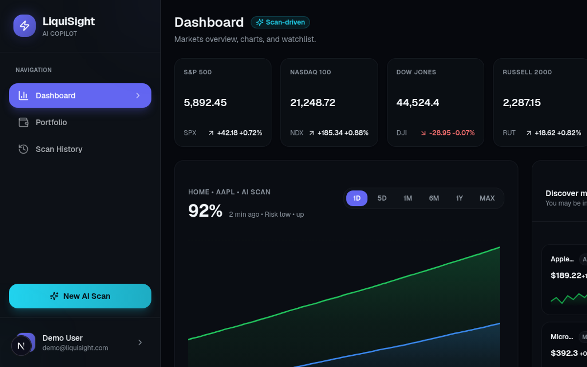
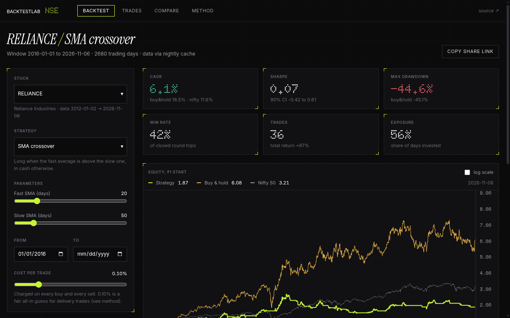
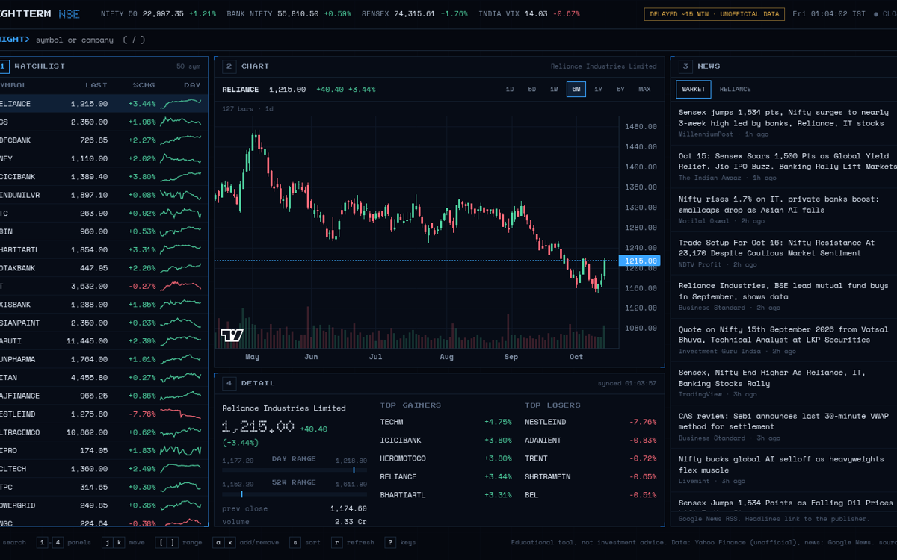
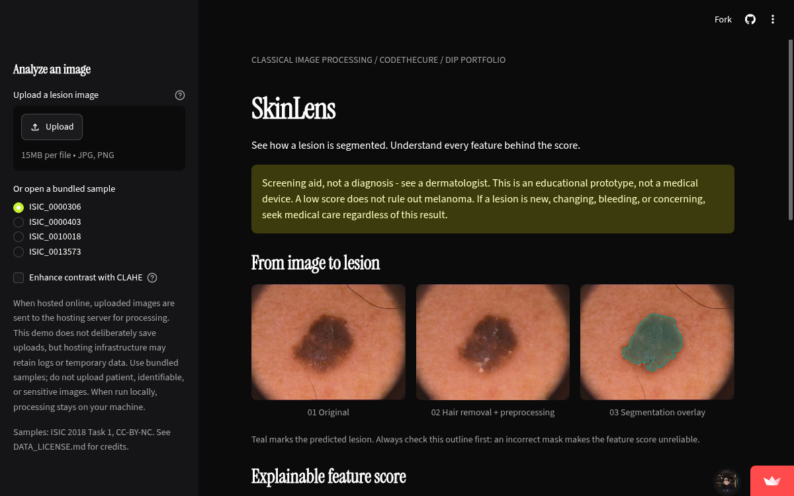

## Hi, I'm Anthony

I'm a dual degree student in computer science from India.

Most of my work sits between two interests: medical imaging you can actually explain, and finance tools for Indian markets.

A few projects I've been building:

<table>
  <tr>
    <td width="50%" valign="top">
      
        
      <a href="https://github.com/mjanthony819/LiquiSight-Extended"><strong>LiquiSight</strong></a>: Visual finance copilot. Chrome extension, FastAPI backend and Next.js dashboard, built to turn a stock chart into structured AI analysis.
        
      <a href="https://github.com/mjanthony819/LiquiSight-Extended">Code</a>
    </td>
    <td width="50%" valign="top">
      
        
      <a href="https://github.com/mjanthony819/backtestlab-nse"><strong>BacktestLab NSE</strong></a>: Backtest simple rules on NSE stocks, costs included, against buy-and-hold and the Nifty. Built to be hard to fool yourself with.
        
      <a href="https://github.com/mjanthony819/backtestlab-nse">Code</a> · 
    </td>
  </tr>
  <tr>
    <td width="50%" valign="top">
      
        
      <a href="https://github.com/mjanthony819/nightterm"><strong>nightterm</strong></a>: Keyboard-driven terminal for the Indian market. NIFTY 50 watchlist, candlesticks and news, no mouse needed.
        
      <a href="https://github.com/mjanthony819/nightterm">Code</a> · <a href="https://mjanthony819.github.io/nightterm/">Live demo</a>
    </td>
    <td width="50%" valign="top">
      
        
      <a href="https://github.com/mjanthony819/SkinLens"><strong>SkinLens</strong></a>: Explainable skin-lesion analysis with classical image processing. Every feature behind the score is visible. Educational prototype, not a diagnosis.
        
      <a href="https://github.com/mjanthony819/SkinLens">Code</a>
    </td>
  </tr>
</table>

**Connect:** [LinkedIn](https://www.linkedin.com/in/m-j-anthony-0646b2299/) · [Email](mailto:mjanthony819@gmail.com) · [Portfolio](https://mjanthony819.github.io/) · Discord `theonewhoace.`

Always happy to chat about markets, imaging, or a project idea.
